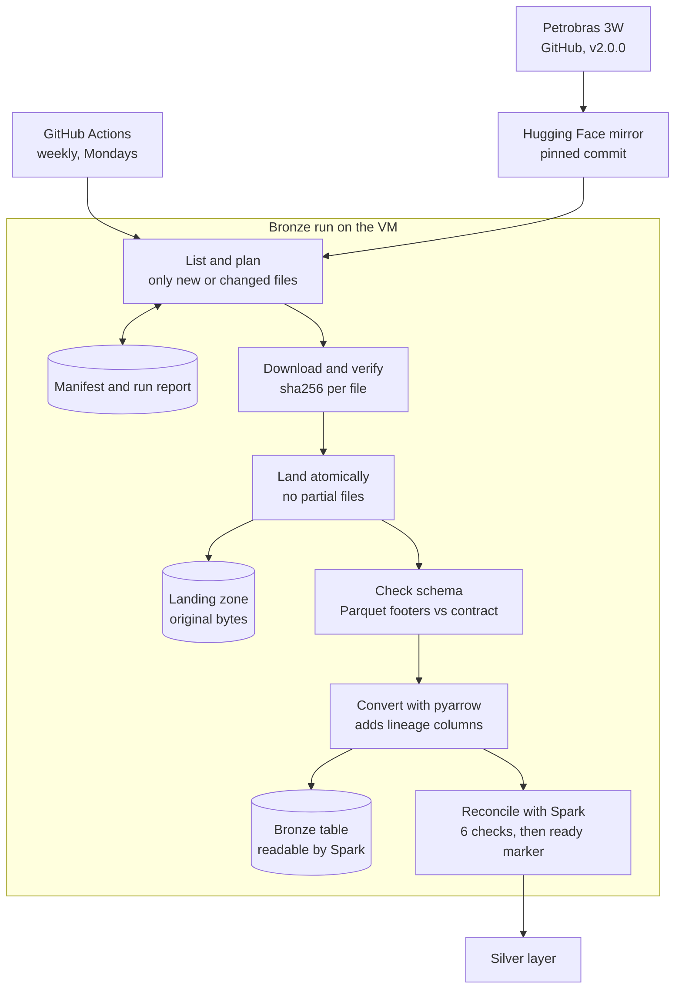

# 3W Data Engineering Project Description

## 1 Project statement

We build a batch data pipeline on Spark that turns the raw Petrobras 3W dataset (v2.0.0) into a governed Gold data product about **well events**: which undesirable events occur on which wells, and how they develop. The pipeline follows the Medallion architecture (Bronze, Silver, Gold) and runs on our UiS OpenStack VM, with GitHub Actions for testing and scheduling.

Gold serves two consumers:

- **Well-operations engineers** use its views to see which events occur on which real wells, how long an event takes to develop from its transient to its steady phase, and how much of that rests on inferred labels. They decide which wells and event types to prioritise.
- **An event-classification team** uses its window feature table to train models and decide which one to deploy. A Random Forest and XGBoost demo shows that the table can be used as delivered.

Silver also serves as a reusable prepared dataset for other analyses.

Out of scope: real-time or streaming ingestion, live well data, dashboards, and deploying a model.

## 2 Dataset description

For the dataset we use the 3W version 2.0.0, the dataset source is initially [here](https://github.com/petrobras/3W), however we mirror it on Hugging Face for easier access. The dataset contains recordings of well behaviour, including sensor readings and event classifications ([`Yahya2491/3w-pipeline`](https://huggingface.co/datasets/Yahya2491/3w-pipeline)). The dataset consists of 2,228 Parquet recordings, approximately 1.87 GB, containing 76,587,318 observations across ten event categories. Each observation contains a timestamp, an observation label (class), a well operational-status field (state), and 27 measurement fields, including continuous readings, choke openings, and valve states. The recordings are split into 1,119 real, 1,089 simulated, and 20 hand-drawn examples. We use `dataset.ini` for the event and sensor definitions.

The dataset contains enough information to support a data engineering project with spark. However the dataset has some limitations. The number of observations makes the dataset suitable for parallel scans, joins, and aggregations using Spark. However, the event categories and source types are unevenly represented, and synthetic recordings cannot be assumed to represent real well behaviour. Sensor coverage varies, four sensor columns have no finite readings, some row labels are missing, and the source timestamps have no documented time zone.

Additionally some source field names use Portuguese terminology or abbreviations, including `ESTADO-*` for valve states and `ABER-*` for choke openings.

## 3 Bronze layer

*Source and preservation.* We publish the 3W dataset unchanged to our own Hugging Face dataset repo (Yahya2491/3w-pipeline). The pipeline pins one exact commit, so every run reads the same data. Upgrading the data is a deliberate config change recorded in Git. Files land on the VM byte for byte as published, organized by ingestion date and event label.

*Ingestion.* Each run lists the files at the pinned commit and compares them with a manifest of what is already stored. It downloads only new or changed files and verifies each one by its sha256 checksum. Files are written atomically, so a failed run never leaves a partial file behind. A second run with no source changes downloads nothing, which makes ingestion idempotent.

*Traceability.* The manifest has one row per file: path, checksum, size, source commit, run ID and status. Each run also writes a JSON run report (files discovered, downloaded, skipped, failed, duration). We key instances by path rather than file name, because 225 instance IDs are reused across different label folders.

*Schema handling.* We check each file's Parquet footer against a schema contract and record any drift.

*Bronze table.* Spark 3.5 cannot read the source files directly, because of the Brotli compression and the nanosecond timestamps. We therefore keep two zones. The landing zone holds the original bytes. The Bronze table holds the same data converted with pyarrow into a Spark-readable format, with lineage columns added. A Spark reconciliation step checks that row counts match the source footers. The full run covers 2,228 files and 76,587,318 rows.

*Testing and deployment.* Separate dev and prod configs set the scale: dev ingests a small sample per class, prod ingests everything. CI runs unit and end-to-end tests against a fake Hugging Face source. A self-hosted runner on the VM executes a weekly scheduled Bronze workflow and publishes the run report as a job summary.

## 4 Silver design

The purpose of the Silver layer is to make the prepared Bronze data easier to understand and use in Gold. We standardise field names, add recording and event details, identify data-quality problems, and prepare clean sensor values. We preserve the source readings in Bronze while also attempting to repair them for some sensors, because detecting a problem does not necessarily tell us what the correct value should be.

### Grain and data model
One row in the main Silver table represents one original observation, with all 27 sensor fields kept as columns. This means that Silver retains the same 76,587,318 observations as Bronze. We do not create a separate observation row for each sensor.

To trace an observation back to its source, we use three fields together: `_source_path` identifies the original file, `_file_sha256` identifies its exact version, and `_row_in_file` identifies the row's original position. The recording name, `instance_id`, is not sufficient on its own because some names appear in more than one event folder. We use the source path and file fingerprint to join each observation to Bronze's current file catalogue and add the recording details.

| Table | Purpose | Rows |
| --- | --- | ---: |
| `silver_observations` | One row per original observation, with clean sensor/class values, provenance and recording/event context. Originals remain in Bronze. | 76,587,318 |
| `instance_quality` | One summary per recording (one original Parquet file), containing observation counts, missing labels, timestamp problems, and overall sensor coverage. | 2,228 |
| `sensor_availability` | One summary per sensor per recording, showing counts and percentages of finite versus missing or nonfinite readings. This describes coverage, not whether every reading is valid. | 60,156 |
| `quality_issues` | Warnings and errors linked to individual observations, with the affected field, reason, and recommended action. Covers label, timestamp, and sensor-value problems; individual null sensor cells are summarised in `sensor_availability` instead. | 4,195,465 |
| `quality_quarantine` | The error-only subset of `quality_issues`, identifying affected measurements, labels, or timestamps for exclusion or further investigation. Observation identities remain in Silver and original readings remain in Bronze. | 167,065 |
| `event_reference` | One definition per event category, containing its readable name and supported observation classes and phases, such as normal, transient, and steady. | 10 |
| `sensor_reference` | One definition per sensor, connecting its original name to its readable English name, meaning, unit, and applicable value rules. | 27 |
`silver_observations` is the main table, while the other six tables provide summaries, issues or reference definitions. The `sensor_reference` and `event_reference` tables are static definitions; the other five tables are generated from the source data.

### Standardisation and event labels

We rename the abbreviated and Portuguese sensor fields using the dataset definitions. For example, `P-PDG` becomes `downhole_pdg_pressure_pa`, `ESTADO-DHSV` becomes `downhole_safety_valve_state`, and `ABER-CKP` becomes `production_choke_opening_pct`. The readings remain in their original units, and the reference table connects each new name to its source field. We also check the expected columns and data types before processing.

The dataset uses two labels that describe different things. `instance_label` identifies the event category of the whole recording, while `class_code` describes the condition at a particular observation. For example, a recording belonging to Event 1 can contain the following classes:

| Class code | Meaning within an Event 1 recording |
| ---: | --- |
| 0 | Normal operation. |
| 101 | The event is developing, referred to as the transient phase. |
| 1 | The event is established, referred to as the steady phase. |
| Missing | No observation label is available. |

These events are usually faults or undesirable operating conditions. Silver adds readable event and phase names alongside the clean class; original supplied codes remain in Bronze.

### Missing values and quality rules

We preserve original readings in Bronze and export one `_clean` value for each of the 27 sensors in Silver. The clean value is the original when it is usable, a limited choke repair when allowed, or null when no usable value is available. We do not replace missing readings with zero or clip values to an allowed range. Zero is not automatically treated as missing. Separate quality tables describe the limitations and identify which observations or fields they affect.

For a finite choke opening outside the documented range of 0–100%, Silver can use the most recent original valid reading from the same uninterrupted sequence, if it is no more than 360 seconds (six minutes) old. The replacement is an estimate; its imputation flag and source age are recorded.
Both [full-run reports](evidence/silver/v3/README.md) record 334 repaired openings
and 161,538 unresolved invalid openings. Missing/non-finite readings are not
imputed, and sequence breaks prevent carry-forward. Without an eligible earlier
original-valid reading, the clean value stays null; no clipping is used.

The export has **79 columns**: ten recording/time/lineage fields, two clean-class
and inference fields, four event descriptions, 27 clean sensors, four choke-repair
fields, two sequence fields, 28 trailing sensor features and two invalid-opening
durations. Duplicate originals remain in Bronze. See the
[contract](silver/SILVER_CONTRACT.md) for definitions and source-name mappings.

`class_code_clean` retains supplied classes and fills leading nulls from the first
supplied class when consistent with the recording event. Internal gaps are filled
only between matching consistent original classes. These are continuity
assumptions, identified by `class_was_inferred`, not recovered expert annotations.
Both builds inferred 4,028,400 missing labels with zero unresolved clean classes.
Original missing-class warnings remain in source-quality tables. Gold allows
inferred targets in training and uses supplied targets for held-out evaluation.

The seven selected sensor families receive 120-second means, sample standard
deviations, previous-reading changes and usable counts. Features use current and
earlier clean values within the same sequence segment. Neither future labels nor
event metadata belong in predictors. Choke-invalid durations describe measurement
quality, not confirmed well events. The [assumptions](silver/SILVER_ASSUMPTIONS.md)
state the remaining limits.

**`instance_quality`: quality of each recording**

This table contains one summary per recording. It includes the observation count, counts of missing classes and operational-status values, timestamp problems, unsupported or inconsistent classes, and the number of sensors with or without finite readings. It provides an overview of the recording rather than listing individual problems.

**`sensor_availability`: coverage of each sensor within a recording**

This table contains one row per sensor per recording. Each row identifies the sensor and recording and contains:

- The total number of observations.
- The number of readings with finite values.
- The number of readings without finite values.
- The percentage of readings with finite values.
- Whether the sensor has at least one finite reading.

A finite value is neither null, NaN, nor infinite. This table measures availability, not validity: a choke opening of 120% is finite but still outside its allowed range. Individual null sensor readings are counted here rather than generating separate quality issues.

**`quality_issues`: individual warnings and errors**

This table identifies specific problems affecting observations. Each entry contains the observation's source key, affected field, failed rule, observed value, severity, reason, affected use, and recommended action. One observation can have several issue entries.

The checks cover:

- Missing, unsupported, or inconsistent observation classes.
- Missing or repeated timestamps and backward time intervals.
- Sampling intervals shorter or longer than the expected one second.
- NaN or infinite sensor readings.
- Valve states outside the documented codes of `0`, `0.5`, and `1`.
- Choke openings outside `0–100%`.
- Observations where none of the 27 sensors has a finite reading.

Different observations sharing a timestamp are retained (although there were none in this dataset), and each affected observation is flagged.

Issues have two severity levels:

| Severity | Meaning | Examples |
| --- | --- | --- |
| **Warning** | A limitation that requires the consumer to account for missing information or unexpected sampling. | Missing observation class; sampling interval shorter or longer than one second. |
| **Error** | A problem affecting the suitability of a measurement, label, or timestamp for its intended use. | Out-of-range opening; unsupported valve state; inconsistent class; missing, repeated, or backward timestamp; NaN or infinity; no finite sensor readings. |

**`quality_quarantine`: the error-only subset**

This table contains the same issue records as `quality_issues`, filtered to severity `error`. It provides convenient access to the errors without including warnings. 

The distinction is therefore:

- `instance_quality` summarises the quality of each recording.
- `sensor_availability` summarises sensor coverage within each recording.
- `quality_issues` identifies individual warnings and errors.
- `quality_quarantine` provides the error-only selection.

### Validation and measured results

Two complete production-input builds validated all seven tables, exact observation
identities/counts, retained source context and prepared values under the saved
rules. Both passed 32 checks. Their independent seven-table comparison includes
nulls and duplicate multiplicities and reports complete-content equality. These
checks establish conformity and repeatability, not the true values of estimates
or the model benefit of features.

### Spark processing and storage

Silver uses PySpark DataFrames, built-in SQL functions and temporal windows.
Complete recordings are processed in batches targeting one million observations;
each full build used 82 batches. Recordings are never split, so repair anchors and
trailing histories remain intact. The full prepared table is not cached, Spark
is stopped between batches, and Parquet write buffers are bounded.

Each build saved 8,549,212,642 bytes of Parquet. Runtimes were 6 h 19 min 21 s and
5 h 51 min 44 s; these are recorded measurements, not a controlled benchmark.
Both wrote under `/mnt/silver-data/3w-data/silver-v3/`. Scheduled Silver is
configured separately for `/mnt/silver-data/silver-schedule/`. Source Bronze
remains under `/home/ubuntu/3w-data/`. See the
[validation report](silver/SILVER_MILESTONE_REPORT.md) and
[run guide](silver/SILVER_RUN_GUIDE.md).

## 5 Gold layer

Gold is one data product, **well events**, built from the published Silver marker.
The [Gold contract](gold/GOLD_CONTRACT.md) defines its consumers, tables, metrics
and checks.

| Table | One row is | Consumer | Rows |
| --- | --- | --- | ---: |
| `recordings` | One recording: well, source, event, time span, inferred-label share. | Operations engineers | 2,228 |
| `event_phases` | One continuous normal, transient or steady stretch of a recording. | Operations engineers | 4,423 |
| `window_features` | One labelled 120-second window per minute, split by whole recording. | Event classifier | 1,259,641 |

*Why it differs from Silver.* Silver keeps one row per observation, 76.6 million
in total. Gold answers questions about events, so its grain is the recording, the
phase and the sampled window.

*Metrics and interfaces.* Normal lead time, time to steady and event duration are
defined once in the contract and computed on demand by two SQL views:
`well_event_summary` for real wells, and `event_type_summary` with real, simulated
and drawn recordings kept apart. The tables are stored because each needs a full
pass over Silver; the views read only the small tables, so they always agree with
them. The classifier reads `window_features` directly.

*Correctness and readiness.* Gold writes each build to its own run folder and checks
the written tables. Phases must cover every Silver row, keys must be unique and
resolve, no recording may be in both splits and no inferred label may be in the
test split. Only then does Gold replace `gold_ready.json`. Otherwise the last good
build stays published, and its marker shows which Silver run it came from. The
full build on 26 October 2026 passed all four checks in 4 min 10 s.

*Usefulness.* The Random Forest and XGBoost demo in `consumers/event_classifier/`
reads `window_features` through the marker and is evaluated on held-out recordings.
On 238,217 test windows, macro F1 is 0.925 for Random Forest and 0.928 for
XGBoost. Over 2,000 recording-level bootstrap resamples the 95% interval of the
difference is −0.004 to +0.009, so the two are tied overall. On real wells they
score 0.633 and 0.660, and XGBoost is ahead in every resample. Both raise many
false alarms in the normal stretch before a real event (67–82% of those windows,
against 3–4% in normal recordings), and 90–100% of those alarms name that
recording's own event. They therefore recognise a recording's operating state
more than the fault onset. A model given only which sensors are
missing scores 0.328, so the features carry signal beyond missingness. Results
are in `consumers/event_classifier/results/`.

*Limits.* Phases and timings rest on the row classes. Each real recording has one
inferred hour in its first phase, and 43 real Event 9 recordings contain no event rows.
Detection at a window endpoint does not establish advance warning before an event
or generalization to unseen wells.

## 6 Delivery and operation

Use the [README](../README.md) for setup, the
[Silver contract](silver/SILVER_CONTRACT.md) for the 79-column interface, and the
[current evidence](evidence/silver/v3/README.md) for the two successful full builds.
The project uses Python 3.11, PySpark 3.5.0 and locked dependencies. CI tests are
offline; production uses the pinned source and the VM runner. Development uses
30 recordings; production processes all 2,228.

All production changes reach main through PRs. Bronze is scheduled Mondays at
03:17 UTC. The Silver workflow follows successful Bronze or CI runs on main,
fetches latest main, records its commit and can reuse unchanged verified output.
New builds retain additional complete output copies; only job-specific temporary
files are automatically cleaned. The saved Silver builds were manual runs and
do not prove that the new scheduled workflow has executed. Gold is built by hand
from the published Silver marker into versioned runs with its own ready marker;
it is not yet started automatically by the Silver workflow.
